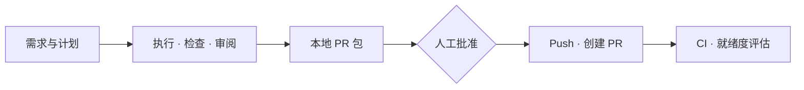

# 天工 Tekon

**简洁透明的本地多 Agent Workflow 桌面工作台。**

本地 Agent workflow 框架：支持**静态模板编排**与**动态蓝图编排**，可自由定义角色（通过本机探测选择器绑定 Agent、模型、Effort 与自定义 Prompt）和跨 Provider 混排节点；通过**双层上下文传递**（通用上下文交接 + 固化 Markdown 文档版本/Diff/置顶 + 同角色会话续接与可逆归档压缩）实现多 Agent 协同。默认 `127.0.0.1` 本地运行，push、创建 PR、合入和上线保留人工控制。

[用户手册 & 部署指南](https://htmlpreview.github.io/?https://github.com/zesming/tekon/blob/main/docs/manual/tekon-user-manual.html#13-多-agent-工作台与部署指南) · [文档索引](docs/README.md) · [产品范围](docs/product/tekon-current-product-scope.md) · [v0.41.0 自举验收](docs/reviews/2026-11-20-tekon-v2-bootstrap.md) · [更新记录](CHANGELOG.md)

## 快速开始

需要 Git、npm 和 Node.js（`^20.19.0` 或 `>=22.12.0`）。已测 Node：20.19、22.12、24.x；未列出的版本不代表已获验证。

```bash
curl -fsSL https://raw.githubusercontent.com/zesming/tekon/main/scripts/install.sh | bash
```

按安装输出配置 PATH，并进入**目标 Git 仓库**（默认 worktree 隔离与 PR 交付需要 Git；非 Git 目录也可运行只含 `workspace: in-place`/`none` 节点的工作流，见[手册 §5.4](docs/manual/tekon-user-manual.md#54-workflow)）。`tekon init` 把已安装的 Claude Code 或 Codex 写成默认 Provider（都没有时为 Claude Code），运行前用 `tekon doctor` 检查安装、登录与检查命令（见[手册 §5.7](docs/manual/tekon-user-manual.md#57-provider)）。

```bash
tekon ui                         # 启动本地 Web，按终端链接进入
# 或直接用 CLI
tekon run "为列表增加筛选条件"
```

CLI 不加 `--agent` 时使用 `.tekon/config.yaml` 的 `defaultAgent`（未配置时默认 `claude-code`）；在 Web 工作台可在「设置 → 角色管理」中按角色通过本机探测下拉选择器绑定各自的 Agent、模型与 Effort，并在首页直接选择静态模板或「✦ 动态编排」发起任务。

首次使用时先运行 `tekon init` 与 `tekon doctor` 确认本机 Agent CLI 就绪；更新使用 `tekon update`。CLI 默认运行轻量 `lightweight-delivery`（plan→实现→人工确认），需要完整评审/QA 全链路时显式选择 `standard-delivery`。

## 从需求到交付



| 你要做什么 | 选择的模板 / 模式 |
| --- | --- |
| 深度技术调研与方案产出（调研→初稿→独立评审→终稿） | `deep-research`（内置 4 节点通用模板，支持跨 Provider 与同角色续接） |
| 快速研发实现与复核 | `quick-dev`（内置线性研发模板） |
| 需求不固定，让编排者自动规划并确认执行步骤 | Web 首页选择 **✦ 动态编排**（支持编辑、重试与另存为模板） |
| 小改动快速实现 + 人工把关（CLI 默认） | `lightweight-delivery` |
| 完整研发交付、需要可审 PR 与 QA 签署 | `standard-delivery`（显式选择） |
| 开发功能 / 修复缺陷 / 补测试 / 改文档 / 只做方案 | `standard-feature` / `bugfix` / `test-improvement` / `docs-update` / `plan-only` |

### 多 Agent 工作台与本机部署

- **桌面双栏交互**：Semi Design 浅色/深色双主题（持久化）、3 档内容宽度（正常 760px / 宽 1080px / 全宽 100%，窄屏自动收窄零横向溢出）、默认收起的顶部点线进度（可应用内一键切换右侧竖向进度轨）、带品牌图标的本机 Agent 级联选择器。
- **双层上下文与可控协同**：节点间经通用交接摘要 + 固化文档（版本 Diff / Pin / 安全导出）传递；支持同角色会话续接与一键重置、确认点定点上游返工、单节点换模型重试、暂停/追加约束/二次确认终止、历史压缩与可逆归档挂载，以及完成后基于固化文档多轮追问。
- **部署与常驻**：支持 `scripts/install.sh` 一键安装、`pnpm build` 源码生产部署、macOS `launchd` / Linux `systemd` 后台常驻与 SSH 端口转发，详见[部署指南（手册 §13）](docs/manual/tekon-user-manual.md#13-多-agent-工作台与部署指南)。

v0.41.0 已完成全仓自动化测试、Chromium Playwright 9 项全流程 E2E 及真实本机 `claude-code` `2.1.327` 自举验证（运行 ID `run_2195c05b-218`），完整证据与未覆盖边界见[v0.41.0 自举验证报告](docs/reviews/2026-11-20-tekon-v2-bootstrap.md)。

运行通过后仍需检查交付证据。**Run passed 不等于 ready**：PR 准备、PR 创建、远端 CI 等必需证据齐全后，readiness 才可能通过。能否交付由冻结计划中的模板 `delivery:` 声明裁决：五个产代码模板（`standard-delivery`、`standard-feature`、`bugfix`、`test-improvement`、`docs-update`）按各自声明评审证据并可走向 PR；默认的 `lightweight-delivery`、`plan-only` 与 goal 模式没有交付声明，结构性不可交付、不会自动产出 PR，Web Prepare 按钮同步禁用并说明原因。升级到 v0.40.0 前的旧运行需重新发起才能交付。

## 日常操作

| 操作 | CLI |
| --- | --- |
| 浏览 / 查看 / 校验工作流模板 | `tekon workflow list` / `show <name>` / `validate <name>` |
| 检查仓库命令 | `tekon workflow preflight` |
| 看运行 / 审阅代码与证据 | `tekon status` / `tekon review` |
| 批准等待中的人工 Gate | `tekon resume --approve-human` |
| 重试终态 failed 的运行（只重跑失败节点） | `tekon retry` |
| 生成本地 PR 材料 | `tekon delivery prepare` |
| 批准 push 并创建 PR | `tekon delivery create-pr --approve-human` |
| 等待 CI / 评估交付完整性 | `tekon delivery ci-watch` / `tekon eval readiness` |

多次运行时加 `--run-id <id>` 指定目标。断连后保留原 Request ID 重试；暂停、取消、旧进程退出确认和恢复见[手册 §7.1](docs/manual/tekon-user-manual.md#71-暂停取消与恢复)。完整命令用 `tekon help`。

## 当前边界

| 可用 | 限制 |
| --- | --- |
| 本地 CLI / Web、受控 workflow、结构化产物、检查与审计 | Session 尚不支持连续追问、中途转向或完整模型流式输出 |
| mock、Codex、Claude Code | `dsh-headless` 为实验性 Provider，默认关闭、网络不受限、仅 Goal 可用 |
| 原请求重试、暂停与显式恢复 | 取消为不可恢复终态；Goal 不接交付流程，默认拒绝源码改动 |
| 当前项目与历史运行查看、清理已结束运行的 worktree 和节点分支 | 无多 Workspace 管理；运行证据和审计不随清理删除 |

适合可回滚、可人工审阅的中小任务。完整权限、执行环境和交付限制见[产品范围](docs/product/tekon-current-product-scope.md)。

## 开发与文档

在 **Tekon 源码仓库**执行：

```bash
npm exec --yes -- pnpm@10.12.1 install --frozen-lockfile
pnpm build
pnpm typecheck
pnpm test --run
```

后续命令也可用 `npm exec --yes -- pnpm@10.12.1` 代替 `pnpm`。

| 入口 | 内容 |
| --- | --- |
| `packages/core` · `packages/cli` · `packages/web` | 工作流引擎 · 命令行 · Web |
| [用户手册](docs/manual/tekon-user-manual.md) | 操作步骤、命令和故障处理 |
| [运行时合同](docs/technical/tekon-runtime-contract.md) · [Web 设计](docs/design/tekon-run-control-design.md) | 状态、恢复、权限与交互约定 |
| [当前验收](docs/reviews/current.md) | 已验证能力、证据和剩余限制 |
